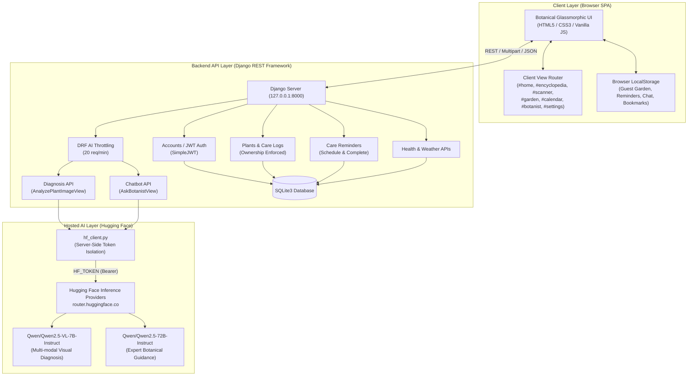

# 🌿 PlantCare — Smart Garden Plant Tracker & AI Botanist

[](https://www.python.org/)
[](https://www.djangoproject.com/)
[](https://www.django-rest-framework.org/)
[](https://huggingface.co/)
[]()
[]()

> A full-stack, botanically styled smart gardening companion featuring **hosted Hugging Face Vision AI photo diagnosis**, an **intelligent AI Botanist conversational assistant**, a **comprehensive plant encyclopedia**, **care calendar reminders**, and **dual-mode garden management** (authenticated JWT cloud sync + local-first guest mode).

---

## 🏛️ System Architecture



---

## ✨ Features & 7 Dedicated Views

### 1. 🏠 Home Dashboard (`#home`)
- **Real Computed Metrics:** Live counters for total garden plants, plants needing attention (water due or unhealthy), upcoming care tasks, and top watering streak.
- **Recent Plants & Care:** Quick cards linking directly to recently added plants and upcoming watering/fertilizing events.
- **Curated Recommendations:** Botanical species suggestions with instant access to encyclopedia details.

### 2. 📖 Plant Encyclopedia (`#encyclopedia`)
- **Rich Species Database:** 10 diverse indoor, outdoor, tropical, fruit, and succulent species (including Monstera, Snake Plant, Fiddle Leaf Fig, Jackfruit, Aloe Vera, Golden Pothos, and Peace Lily).
- **Multi-Dimensional Filtering:** Search by common name, scientific name, or description; filter by category, care difficulty (`Easy`, `Moderate`, `Difficult`), sunlight requirements (`Low Light`, `Bright Indirect`, `Direct Sunlight`), and watering frequency (`frequent`, `moderate`, `sparse`).
- **Comprehensive Botanical Modals:** Shows plant family, water schedule, light, humidity, temperature tolerance, pet toxicity warnings, recommended soil mix, fertilizer schedule, propagation methods, and common physiological/pest problems.
- **Quick Actions:** Bookmark to favorites, add directly to personal garden, or jump to AI Botanist with context.

### 3. 📷 AI Plant Scanner (`#scanner`)
- **Hosted Hugging Face Vision AI:** Powered by `Qwen/Qwen2.5-VL-7B-Instruct`. Analyzes leaf photos in real time.
- **Multiple Capture Modes:** Upload local image files or capture live photos directly using your device's webcam/camera (`navigator.mediaDevices.getUserMedia`).
- **Image Controls:** Preview, clear, or replace uploaded photos at any time.
- **Structured AI Diagnostic Output:** Identifies plant species, health score (0–100), visual symptoms, potential root/environmental causes, and step-by-step recovery actions.
- **Scientific Honesty & Uncertainty:** Displays an explicit uncertainty disclaimer acknowledging the physical limitations of single-photo visual triage (e.g., inability to diagnose subterranean root pathogens or microbial soil issues).
- **Reference Examples:** Clearly labeled sample photographs available for offline exploration without consuming AI quota.
- **One-Click Garden Save:** Add identified species directly to your garden with one click.

### 4. 🪴 My Garden (`#garden`)
- **Dual-Mode Operation:**
  - **Guest Mode (Local-First):** Full CRUD capability stored safely in browser `localStorage`.
  - **Authenticated Mode (Cloud Sync):** Backed by Django REST Framework with per-user data isolation and JWT authentication.
- **Watering Tracking & Progress:** Per-plant visual water progress bar, countdown to next watering, and consecutive care streak counters.
- **Care History Timeline:** Per-plant activity log tracking watering, fertilizing, repotting, and health notes with exact timestamps.
- **Quick Care Actions:** "Water Now" button instantly updates watering countdown and logs an entry to care history.

### 5. 📅 Care Calendar & Reminders (`#calendar`)
- **Three-Tier Status Breakdown:** Automatically categorizes tasks into **Overdue**, **Upcoming**, and **Completed** columns.
- **Task Scheduling:** Schedule watering, fertilizing, repotting, or custom care tasks for any plant in your garden.
- **Browser Desktop Notifications:** Request and manage browser notification permissions (`Notification.requestPermission()`) for alerts while PlantCare is open.
- **Filtering:** Filter care tasks by specific plant or completion status.

### 6. 🤖 AI Botanist (`#botanist`)
- **Hosted Hugging Face LLM:** Powered by `Qwen/Qwen2.5-72B-Instruct` via server-side chat completions.
- **Botanically Grounded System Prompt:** Instructed to provide scientifically accurate horticulture advice, avoid inventing unverified facts, and clearly delineate when physical soil/root inspection is needed.
- **Conversation History:** Retains multi-turn dialogue context across the session.
- **Plant Context-Aware:** Can receive current plant context for tailored advice.
- **XSS-Safe Markdown:** Sanitizes all input using strict HTML entity escaping and renders safe formatting for bold, italic, and line breaks.

### 7. ⚙️ Settings & Data Portability (`#settings`)
- **Full JSON Backup Export:** Download your entire garden, favorites, care reminders, and chat history as a portable `.json` file.
- **JSON Backup Import:** Restore previously saved garden states with full validation.
- **Notification Manager:** View current browser notification permission status and trigger authorization requests.

---

## 🔒 Security Architecture & AI Token Isolation

1. **Zero Client-Side Token Exposure:** The Hugging Face User Access Token (`HF_TOKEN`) is stored strictly in `backend/.env` on the server. The frontend never receives, stores, or handles AI credentials.
2. **DRF AI Rate Limiting:** Both `/api/diagnosis/analyze/` and `/api/chatbot/ask/` enforce a scoped rate limit (`ai_inference: 20/minute`) via Django REST Framework throttling to safeguard hosted API quotas.
3. **File Upload Restrictions:** The vision analysis endpoint strictly validates image mime types (`image/jpeg`, `image/png`, `image/webp`) and enforces a 10MB maximum file size limit.
4. **Data Isolation:** All database querysets filter by `request.user`. Users cannot view, modify, or assign care logs or reminders to plants owned by other users.
5. **Cross-Site Scripting (XSS) Prevention:** Dynamic content and user messages are escaped via DOM `textContent` before rendering.

---

## 🚀 Quick Start Guide

### Prerequisites
- **Python 3.12+** (required by Django 6.1.3)
- Modern web browser (Chrome, Firefox, Edge, Safari)
- A Hugging Face account (for hosted AI inference)

---

### Step 1: Clone Repository
```powershell
git clone https://github.com/your-username/PlantCare.git
cd PlantCare
```

---

### Step 2: Configure Environment Variables
Copy the template configuration in `backend/`:
```powershell
cp backend/.env.example backend/.env
```

Open `backend/.env` in your text editor:
```ini
SECRET_KEY=generate-a-secure-random-key-here
DEBUG=True

# Hugging Face Inference Providers
HF_ROUTER_URL=https://router.huggingface.co/v1/chat/completions
HF_TOKEN=hf_your_actual_token_here
HF_VISION_MODEL=Qwen/Qwen2.5-VL-7B-Instruct
HF_CHAT_MODEL=Qwen/Qwen2.5-72B-Instruct
```

#### How to get a free `HF_TOKEN`:
1. Log in to [Hugging Face](https://huggingface.co/).
2. Navigate to **Settings → Access Tokens** (`https://huggingface.co/settings/tokens`).
3. Click **Create new token**.
4. Select **Type: Fine-grained** or **Read**, and ensure **"Make calls to Inference Providers"** is checked.
5. Copy the generated token and paste it into `HF_TOKEN` in `backend/.env`.

---

### Step 3: Set Up and Run the Backend

#### Option A: Using `uv` (Recommended — Fast & Automatic Python 3.12)
```powershell
# Run migrations
uv run --python 3.12 --with-requirements backend\requirements.txt python backend\manage.py migrate

# Start development server
uv run --python 3.12 --with-requirements backend\requirements.txt python backend\manage.py runserver 127.0.0.1:8000
```

#### Option B: Using Standard Python Virtual Environment
```powershell
cd backend
python -m venv venv
.\venv\Scripts\activate
pip install -r requirements.txt
python manage.py migrate
python manage.py runserver 127.0.0.1:8000
```

The Django REST API will be running at **`http://127.0.0.1:8000`**.

---

### Step 4: Launch the Frontend

In a separate terminal:
```powershell
# From the project root (PlantCare/)
python -m http.server 8080
```

Open your browser at **`http://localhost:8080`**.

> 💡 **Tip:** While the app can also be opened via `file:///.../index.html` for guest local-first exploration, serving it via `http://localhost:8080` is required for JWT cookie handling, camera access (`getUserMedia` requires secure or localhost origin), and full backend sync.

---

## 🧪 Running Automated Tests

PlantCare comes with **40 automated tests** covering accounts, plants, diagnosis, health scoring, weather, care reminders, and chatbot workflows.

Run the entire test suite:
```powershell
uv run --python 3.12 --with-requirements backend\requirements.txt python backend\manage.py test accounts plants diagnosis plant_health weather reminders chatbot -v 2
```

### Test Coverage Breakdown
| Test Suite | Test Cases | Scope |
|---|:---:|---|
| `accounts` | 8 | Registration, profile, JWT token generation & validation |
| `plants` | 8 | Plant CRUD, care logs, ownership filtering |
| `diagnosis` | 6 | Diagnosis models, serializers, live AI vision mock testing |
| `plant_health` | 4 | Health score recording & validation |
| `weather` | 4 | Environmental conditions tracking |
| `reminders` | 5 | Scheduling, completion status, filtering |
| `chatbot` | 5 | History persistence, AI botanist endpoint & payload validation |
| **Total** | **40** | **100% Pass** |

---

## 📁 Directory Structure

```
PlantCare/
├── index.html              # Single-page application with 7 dedicated views
├── css/
│   └── styles.css          # Botanical glassmorphic design system & responsive layout
├── js/
│   ├── plantData.js        # 10 comprehensive botanical plant profiles & reference samples
│   ├── app.js              # Router, computed metrics, AI scanner, calendar, botanist
│   ├── api.js              # JWT token management & authenticated fetch wrapper
│   ├── auth.js             # User login, registration modal, and auth state dispatch
│   ├── profile.js          # User profile view, edit, and avatar upload
│   ├── plants.js           # Backend plant CRUD and care log synchronization
│   └── reminders.js        # Backend reminder operations
├── backend/
│   ├── manage.py
│   ├── requirements.txt    # Django, DRF, SimpleJWT, Pillow, Requests, Dotenv
│   ├── .env.example        # Environment variable template
│   ├── API_DOCUMENTATION.md# Detailed REST API endpoint specification
│   ├── config/             # Settings, URL routing, shared Hugging Face client
│   │   ├── settings.py     # Configuration, media root, rate throttling
│   │   ├── urls.py         # Root URL router
│   │   └── hf_client.py    # Robust HTTP client for Hugging Face Inference Providers
│   ├── accounts/           # User authentication & profile management
│   ├── plants/             # Plant collection & care log management
│   ├── diagnosis/          # AI Vision analysis & diagnostic records
│   ├── plant_health/       # Plant health status & score history
│   ├── weather/            # Environmental condition logs
│   ├── reminders/          # Care reminders & completion tracking
│   └── chatbot/            # AI Botanist chat service & history persistence
└── README.md
```

---

## 🔬 Scientific & Operational Limitations

1. **Photographic Triage Limitations:** Plant diseases often originate at the root system or present microscopic pathogens not identifiable via a single exterior photograph. The AI Plant Scanner is designed as an initial screening companion and will clearly flag uncertainty where visual evidence is insufficient.
2. **Hosted Inference Availability:** Hugging Face hosted serverless inference routes may experience temporary cold-starts (503) or monthly quota constraints on free accounts. The backend handles this gracefully with retry mechanisms and informative error messaging.
3. **Browser Notifications:** In-browser notification alerts require the tab to be active or running in the background and depends on user permission grants.

---

## 📄 License
This project is open-source and available under the [MIT License](LICENSE).
